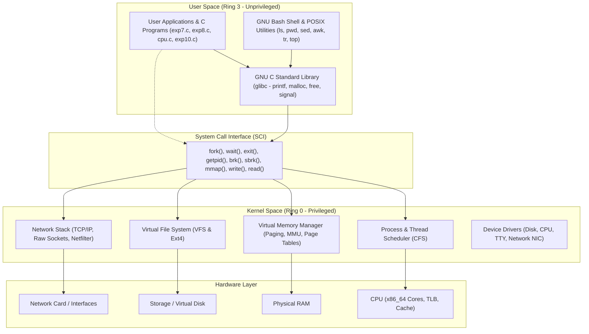
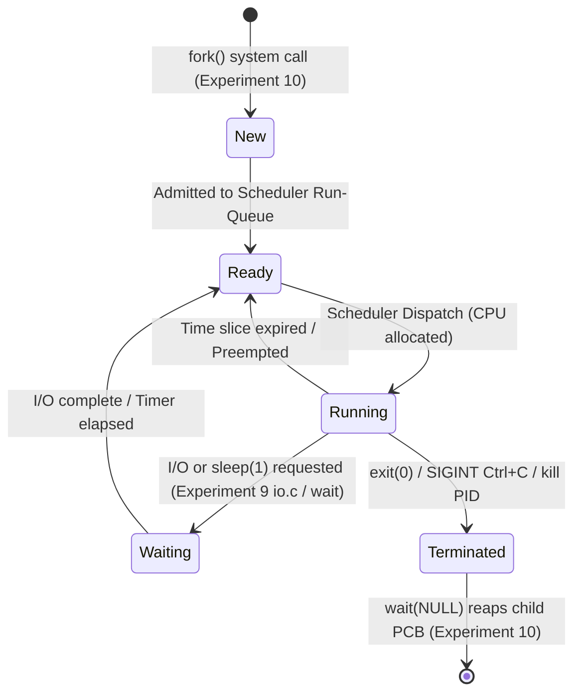
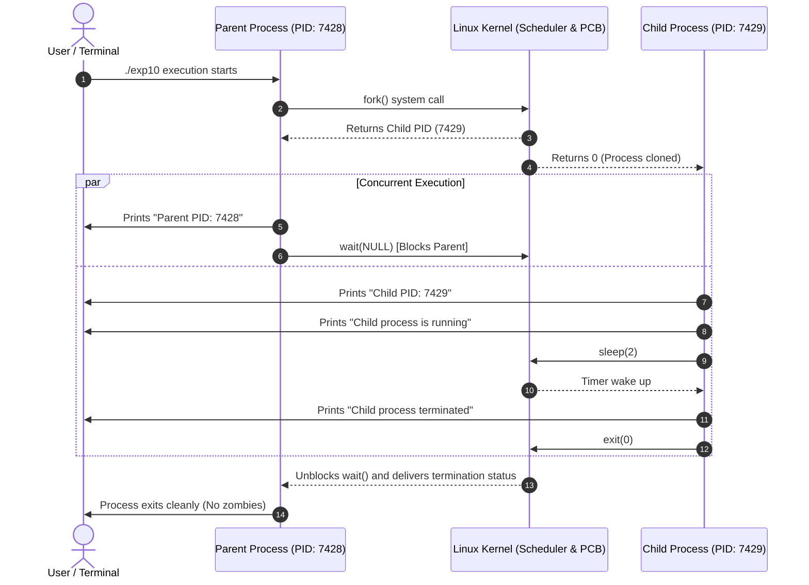
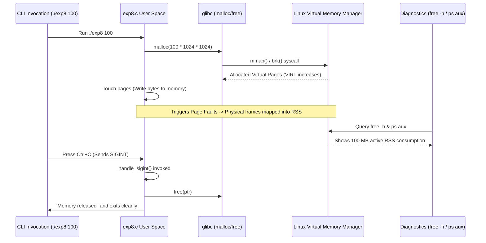
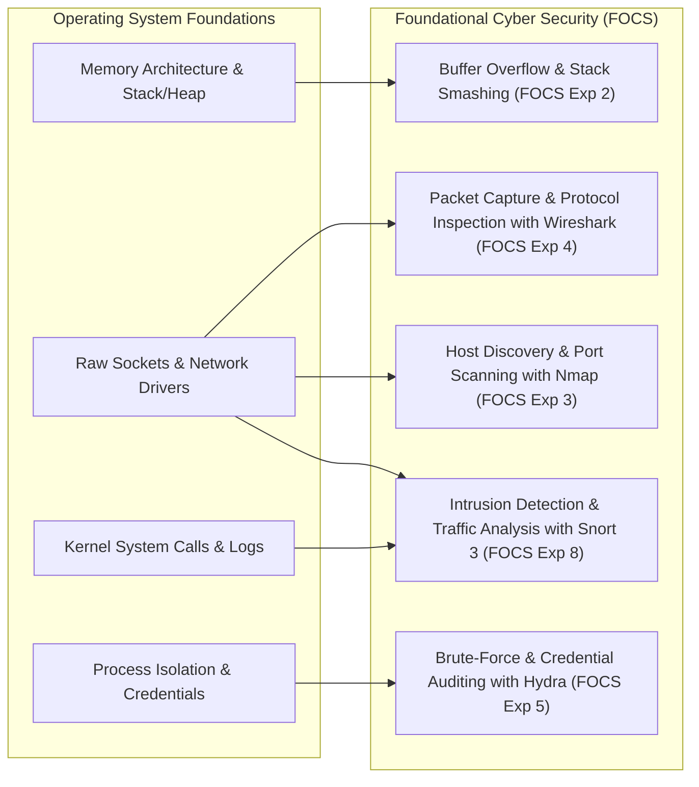

# System Architecture & Laboratory Design

This document describes the architectural foundations, Linux kernel subsystems, process management lifecycles, and memory hierarchy demonstrated across the practical experiments in this repository.

---

## 1. High-Level Operating System Architecture

The Linux operating system follows a monolithic kernel architecture with modular subsystem separation. Applications run in unprivileged User Mode (Ring 3) and interact with the kernel through the System Call Interface (SCI) to execute privileged operations in Kernel Mode (Ring 0).

---

## 2. Process Lifecycle & State Transition Architecture

In Linux, process execution follows a defined lifecycle managed by the Completely Fair Scheduler (CFS). Experiments 4, 9, and 10 explicitly exercise and diagnose these state transitions.

### Parent-Child Process Synchronization Flow (`exp10.c`)

---

## 3. Virtual Memory Architecture & Address Space Layout

Linux allocates each 64-bit user-space process a private 48-bit canonical virtual address space (0x000000000000 to 0x7FFFFFFFFFFF). This layout was analyzed in **Experiment 8** (`malloc`, `free`) and **Experiment 9** using `pmap -x`.

```mermaid
flowchart TD
    subgraph VirtualAddressSpace["Process Virtual Address Space (64-bit Linux)"]
        KernelSeg["Kernel Space (Reserved - 0xFFFF800000000000+)"]
        StackSeg["Stack Segment (Local variables, function frames) - Grows DOWN ⬇️"]
        Gap1["Unallocated Virtual Address Space"]
        MmapSeg["Memory Mapping Segment (Shared Libraries: libc.so, ld.so)"]
        Gap2["Unallocated Virtual Address Space"]
        HeapSeg["Heap Segment (Dynamic allocation via malloc/brk/sbrk) - Grows UP ⬆️"]
        BSSSeg["BSS Segment (Uninitialized global and static data)"]
        DataSeg["Data Segment (Initialized global and static variables)"]
        TextSeg["Text Segment (Binary machine instructions - Read-Only & Executable)"]
    end

    TextSeg --> DataSeg --> BSSSeg --> HeapSeg -.-> Gap2 -.-> MmapSeg -.-> Gap1 -.-> StackSeg --> KernelSeg
```

### Memory Allocation & Inspection Workflow (`exp8.c`)

---

## 4. Laboratory Experiments Architecture Mapping

| Layer | Experiments | Core Operating System Mechanism |
| :--- | :--- | :--- |
| **System Virtualization** | **Experiment 1** | Type-2 Hypervisor VirtualBox, Hardware Virtualization, ISO Bootloader, Root FS Installation. |
| **POSIX Shell & Filesystem** | **Experiment 2(a), 2(b)** | VFS Inodes, Directory Trees, Path Resolution (`pwd -P/-L`), POSIX file manipulation (`mkdir`, `rm`, `touch`). |
| **I/O Redirection & Text Streams** | **Experiment 3(a), 3(b)** | Standard Streams (`stdin=0, stdout=1, stderr=2`), Pipes (`pipe()`), Regex pattern capture groups with `sed`. |
| **Process Control & Monitoring** | **Experiment 4** | Process Control Block (`/proc`), Signals (`SIGKILL`, `SIGTERM`), Background jobs (`&`), `top`, `ps aux`. |
| **Shell Programming & Automation** | **Experiment 5(a), 5(b)** | Shell script parameter expansion (`$1`), file system test operators (`-f`, `-d`), character translation (`tr`). |
| **User Accounting & Advanced Sed**| **Experiment 6(a), 6(b), 6(c)** | User login accounting (`/var/run/utmp`, `who`, `awk`), parameterized stream editing, multi-file iteration. |
| **Benchmarking & Performance** | **Experiment 7** | Compiled native C execution vs Interpreted shell overhead, POSIX `time` metrics (User vs Sys vs Real). |
| **Dynamic Memory & Signals** | **Experiment 8** | Dynamic heap allocation (`malloc`), Resident Set Size (RSS), Signal Interception (`signal(SIGINT)`). |
| **Scheduler & Resource Analysis** | **Experiment 9** | CPU-bound vs I/O-bound process scheduling, CPU burst behavior, Virtual Memory Mapping examination (`pmap -x`). |
| **Process Hierarchy & System Calls** | **Experiment 10** | Process creation (`fork()`), Process Identification (`getpid()`), Parent-Child synchronization (`wait()`, `exit()`). |

---

## 5. Cross-Disciplinary Architecture: Operating Systems & Cyber Security Synergy

The mechanisms provided by the operating system serve as the direct foundation for foundational cyber security concepts:

