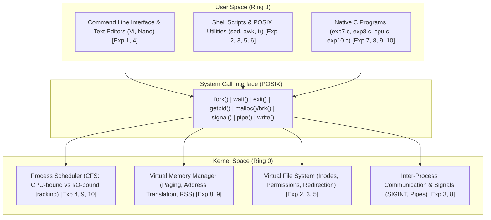

# Operating System Lab (OS Lab) — Practical Manifest & Architecture

[](https://ubuntu.com/)
[](https://kernel.org/)
[](https://www.gnu.org/software/bash/)
[](https://gcc.gnu.org/)
[](https://github.com/MirzaYounisHussain)

This repository contains the comprehensive lab implementations, C programs, POSIX shell scripts, system call demonstrations, diagnostic traces, and execution output documentation for the **Operating Systems Practical Laboratory Course**.

It includes an **Operating System Architecture Manifest**, detailed experiment walkthroughs designed for **classroom presentation**, and a dedicated cross-disciplinary index detailing the practical experiments completed in **Foundational Cyber Security (FOCS)**.

---

## 📑 Lab Manifest (Index of Experiments)

> 💡 **Quick Code Access:** All scripts, C source programs, and plain-text files are consolidated in the **[`All_Experiment_Codes/`](file:///All_Experiment_Codes/)** folder, including the complete **[`ALL_EXPERIMENTS_MASTER_CODE.txt`](file:///All_Experiment_Codes/ALL_EXPERIMENTS_MASTER_CODE.txt)** file.

| Exp # | Sub-Part | Date | Title / Topic | Primary Code / Script | Plain Text (.txt) | Outputs & Documents |
| :---: | :---: | :---: | :--- | :--- | :--- | :--- |
| **1** | — | 17-08-2026 | **Virtualization & Ubuntu OS Setup** | [`exp1_verification.sh`](file:///Experiment%201/exp1_verification.sh) | [`exp1_verification.txt`](file:///Experiment%201/exp1_verification.txt) | [`Experiment 1`](file:///Experiment%201/Experiment%201), `outputs.pdf` |
| **2** | **(a)** | 19-08-2026 | **Working with Basic Bash Commands** | [`exp2a_basic_commands.sh`](file:///Experiment%202/exp2a_basic_commands.sh) | [`exp2a_basic_commands.txt`](file:///Experiment%202/exp2a_basic_commands.txt) | [`Experiment 2(a)`](file:///Experiment%202/Experiment%202(a)) |
| **2** | **(b)** | 19-08-2026 | **Flowchart-Based Directory Hierarchy** | [`exp2b_directory_tree.sh`](file:///Experiment%202/exp2b_directory_tree.sh) | [`exp2b_directory_tree.txt`](file:///Experiment%202/exp2b_directory_tree.txt) | [`Experiment 2(b)`](file:///Experiment%202/Experiment%202(b)), `outputs.pdf` |
| **3** | **(a)** | 24-08-2026 | **Command Chaining & Output Redirection** | [`exp3a_pipe_redirection.sh`](file:///Experiment%203/exp3a_pipe_redirection.sh) | [`exp3a_pipe_redirection.txt`](file:///Experiment%203/exp3a_pipe_redirection.txt) | [`Experiment 3(a)`](file:///Experiment%203/Experiment%203(a)), `output.pdf` |
| **3** | **(b)** | 24-08-2026 | **Stream Text Transformation with Sed** | [`exp3b_sed_swap.sh`](file:///Experiment%203/exp3b_sed_swap.sh) | [`exp3b_sed_swap.txt`](file:///Experiment%203/exp3b_sed_swap.txt) | [`Experiment 3 (b)`](file:///Experiment%203/Experiment%203%20(b)), `outputs.pdf` |
| **4** | — | 31-08-2026 | **Process Management & Linux Text Editors** | [`exp4_process_management.sh`](file:///Experiment%204/exp4_process_management.sh) | [`exp4_process_management.txt`](file:///Experiment%204/exp4_process_management.txt) | [`Experiment 4`](file:///Experiment%204/Experiment%204), `outputs.pdf` |
| **5** | **(a)** | 07-09-2026 | **File vs Directory Classifier Script** | [`exp5a.sh`](file:///Experiment%205/exp5a.sh) | [`exp5a.txt`](file:///Experiment%205/exp5a.txt) | `Experiment 5(a) outputs .pdf` |
| **5** | **(b)** | 09-09-2026 | **Filename Uppercase Converter Script** | [`exp5b.sh`](file:///Experiment%205/exp5b.sh) | [`exp5b.txt`](file:///Experiment%205/exp5b.txt) | `Experiment 5(b) outputs.pdf` |
| **6** | **(a)** | 13-09-2026 | **User Session Duration & Login Tracker** | [`exp6a.sh`](file:///Experiment%206/exp6a.sh) | [`exp6a.txt`](file:///Experiment%206/exp6a.txt) | `Experiment 6(a) output .pdf` |
| **6** | **(b)** | 13-09-2026 | **Line Range Extractor Script** | [`exp6b.sh`](file:///Experiment%206/exp6b.sh) | [`exp6b.txt`](file:///Experiment%206/exp6b.txt) | `Experiment 6(b) output .pdf` |
| **6** | **(c)** | 13-09-2026 | **Multi-File Word Deletion Script** | [`exp6c.sh`](file:///Experiment%206/exp6c.sh) | [`exp6c.txt`](file:///Experiment%206/exp6c.txt) | `Experiment 6(c) output .pdf` |
| **7** | — | Sept 2026 | **String Operations & Benchmarking (C vs Shell)** | [`exp7.c`](file:///Experiment%207/exp7.c) / [`exp7.sh`](file:///Experiment%207/exp7.sh) | [`exp7_c.txt`](file:///Experiment%207/exp7_c.txt) / [`exp7_sh.txt`](file:///Experiment%207/exp7_sh.txt) | `Experiment 7 outputs .pdf` |
| **8** | — | 28-09-2026 | **Dynamic Memory Allocation & Monitoring** | [`exp8.c`](file:///Experiment%208/exp8.c) | [`exp8_c.txt`](file:///Experiment%208/exp8_c.txt) | `Experiment 8 outputs .pdf` |
| **9** | — | 01-11-2026 | **CPU-Bound vs I/O-Bound Scheduling Analysis** | [`cpu.c`](file:///Experiment%209/cpu.c) / [`io.c`](file:///Experiment%209/io.c) / [`exp9_monitor.sh`](file:///Experiment%209/exp9_monitor.sh) | [`cpu_c.txt`](file:///Experiment%209/cpu_c.txt) / [`io_c.txt`](file:///Experiment%209/io_c.txt) | [Exp 9 Analysis](file:///Experiment%209/Experiment%209%20CPU%20vs%20IO%20Bound%20Analysis.md), `Screenshots.pdf` |
| **10** | — | 01-11-2026 | **Process Creation & Synchronization** | [`exp10.c`](file:///Experiment%2010/exp10.c) | [`exp10_c.txt`](file:///Experiment%2010/exp10_c.txt) | [Exp 10 Analysis](file:///Experiment%2010/Experiment%2010%20Process%20Management.md), `Screenshots.pdf` |

---

## 🏛️ Operating System Architecture Overview

The lab exercises progress systematically through the core subsystems of a modern operating system:



> **Detailed Architecture Reference:** For deeper diagrams and sequence flows of process state transitions, virtual address layout (`pmap`), and memory paging, see [ARCHITECTURE.md](file:///ARCHITECTURE.md).

---

## 🔬 Detailed Experiment Walkthroughs

### Experiment 1: Virtualization & Ubuntu OS Setup
- **Objective:** Deploy and configure a virtualized Linux development environment.
- **Methodology:** Setup Oracle VirtualBox (Type-2 Hypervisor), allocate virtual hardware resources (RAM, CPU cores, dynamically allocated virtual disk), mount the Ubuntu 64-bit desktop ISO image, and configure root/user partitions.
- **Key Concepts:** Hypervisor architecture, virtual machines, kernel boot sequence, user privilege configuration.

---

### Experiment 2: Linux Shell Fundamentals & Directory Management
- **Part (a) — Core Bash Commands:**
  - Directory Navigation: `pwd -P`, `pwd -L`, `cd ..`, `cd ~`, `cd <dir>`.
  - Directory Listing: `ls -l` (detailed permissions/ownership), `ls -a` (hidden entries), `ls -lt` (sorted by modification time).
  - Creation & Deletion: `mkdir -p` (hierarchical creation), `rmdir -p`, `rm -rf`, `touch` (timestamps and file instantiation).
- **Part (b) — Flowchart-Based Hierarchical Organization:**
  - Implemented the semester academic directory structure:
    ```text
    Sem_3/
    ├── COA/    ── [ Practical | Theory ]
    ├── HSMC/   ── [ Book | Class ]
    ├── OS/     ── [ Theory | Lab ]
    └── cyber/  ── [ Lab | Theory ]
    ```

---

### Experiment 3: I/O Redirection & Stream Text Processing
- **Part (a) — Sequential Command Chaining & Redirection:**
  - Executed: `date; w | cat > who.txt`
  - Demonstrates command sequencing via `;`, standard pipeline execution via `|`, and file descriptor stdout redirection (`>`) to capture active session telemetry.
- **Part (b) — Stream Transformation using Sed:**
  - Executed: `sed -i 's/^\([^ ]*\) \(.*\)$/\2 \1/' name.txt`
  - Uses POSIX regular expressions with capture groups `\1` and `\2` to swap first and last words across every record in-place (`-i`).

---

### Experiment 4: Process Management & Editor Mastery
- **Process Inspection:**
  - `ps` (terminal session processes), `ps aux` (global system processes with user/CPU/memory telemetry), `top` (dynamic real-time process monitoring).
- **Process Signaling & Job Control:**
  - `pgrep <name>` to resolve Process IDs.
  - `kill <PID>` to issue software termination signals.
  - Appending `&` to run processes asynchronously in the background; `jobs` and `fg` to manage the process job queue.
- **Text File Editing:** File creation, editing, and modal operation in `nano` and `vi`/`vim`.

---

### Experiment 5: Shell Scripting — Conditional Branching & String Transformation
- **Part (a) — File Type Classifier (`exp5a.sh`):**
  - Accepts a path argument (`$1`) and evaluates filesystem status using test conditions:
    ```bash
    if [ -f "$1" ]; then echo "$1 is a file";
    elif [ -d "$1" ]; then echo "$1 is a directory";
    else echo "$1 does not exist"; fi
    ```
- **Part (b) — Uppercase Filename Translation (`exp5b.sh`):**
  - Translates lowercase filename strings to uppercase using character substitution:
    ```bash
    mv "$1" "$(echo "$1" | tr '[:lower:]' '[:upper:]')"
    ```

---

### Experiment 6: User Tracking & Stream Operations
- **Part (a) — User Login Duration Tracker (`exp6a.sh`):**
  - Interactively queries user presence and parses login timestamps from `who` using `awk`:
    ```bash
    login_time=$(who | awk -v u="$user" '$1 == u {print $3, $4; exit}')
    ```
- **Part (b) — Specific Line Range Extraction (`exp6b.sh`):**
  - Extracts line ranges `[start, end]` from target files using `sed -n "${start},${end}p" "$file"`.
- **Part (c) — Variadic Word Removal Script (`exp6c.sh`):**
  - Traverses an arbitrary argument list of filenames (`"$@"`) and purges lines containing target words via `sed -i "/$word/d" "$file"`.

---

### Experiment 7: String Operations & Performance Benchmarking (C vs Shell)
- **Objective:** Compare runtime performance and algorithmic efficiency between compiled native binary code (`exp7.c`) and interpreted shell execution (`exp7.sh`).
- **Operations:** String length computation and substring slicing.
- **Benchmarking via `time` Command:**
  - Compiled C (`./string`): Execution completed with near-instantaneous CPU time (`user: 0.001s`, `sys: 0.001s`).
  - Shell Script (`./exp7.sh`): Incurred higher execution latency due to subshell forks and bash interpreter overhead.

---

### Experiment 8: Dynamic Memory Allocation & Linux Memory Telemetry
- **Source:** [`exp8.c`](file:///Experiment%208/exp8.c)
- **Mechanism:**
  1. Accepts allocation volume in Megabytes via CLI argument (`argv[1]`).
  2. Allocates dynamic memory on the heap using `malloc(bytes)`.
  3. Writes to memory pages in 4 KB strides to trigger **Minor Page Faults**, ensuring physical frame backing in **Resident Set Size (RSS)**.
  4. Intercepts the `SIGINT` signal (`Ctrl+C`) via `signal(SIGINT, handle_sigint)`.
  5. Monitored through `free -h` and `ps aux | grep exp8`.
  6. On termination, explicitly deallocates memory via `free()` to prevent resource leaks.

---

### Experiment 9: CPU-Bound vs I/O-Bound Scheduling & Memory Mapping
- **Sources:** [`cpu.c`](file:///Experiment%209/cpu.c), [`io.c`](file:///Experiment%209/io.c)
- **Comparative Analysis:**
  - `cpu.c`: Infinite mathematical loop launched in background (`./cpu &`). `top` verifies **~99.7% CPU utilization** in Running (`R`) state.
  - `io.c`: Sleep/I/O cycle process launched in background (`./io &`). `top` verifies **~0.4% CPU utilization** in Sleeping (`S`) state.
- **Virtual Memory Mapping via `pmap -x <PID>`:**
  - Examined the exact virtual address map of both processes:
    - Text and Read-Only Data (`r-xp`, `r--p`)
    - Dynamic Heap Segment (`[heap]`, `rw-p`)
    - Shared C Library mappings (`libc.so.6`)
    - Process Stack (`[stack]`)
    - Kernel Auxiliary Pages (`[vvar]`, `[vdso]`, `[vsyscall]`)

---

### Experiment 10: Process Creation & Synchronization with POSIX System Calls
- **Source:** [`exp10.c`](file:///Experiment%2010/exp10.c)
- **System Call Workflow:**
  1. `fork()`: Creates a new child process by cloning the parent's address space and PCB.
  2. Evaluates return code:
     - `p == 0`: Executes child routine, displays child PID via `getpid()`, sleeps 2 seconds, and calls `exit(0)`.
     - `p > 0`: Executes parent routine, prints parent PID, and invokes `wait(NULL)`.
  3. `wait(NULL)` blocks parent execution until the child terminates, preventing **zombie process accumulation** and ensuring orderly kernel resource reclamation.

---

## 🛡️ Foundational Cyber Security (FOCS) Lab Manifest

The operating system's internal architectures (process isolation, stack/heap layout, kernel networking, and system calls) provide the direct foundation for cyber security. Below is the manifest of practical security experiments completed in conjunction with this course:

| Exp # | Experiment Title | Security Domain | Tools / Environment | Core Cyber Security Mechanism |
| :---: | :--- | :--- | :--- | :--- |
| **1** | **Information Gathering via Google Dorking** | Reconnaissance / OSINT | Google Search Engine | Advanced search operators (`site:`, `filetype:`, `inurl:`, `intitle:`) to locate exposed credentials and vulnerable endpoints. |
| **2** | **Buffer Overflow Vulnerability & Mitigation** | Binary Exploitation | C, GCC (`-fno-stack-protector`) | Corrupting stack memory by exceeding array bounds; overwriting the instruction pointer (`EIP`/`RIP`); studying stack canaries and ASLR. |
| **3** | **Host Scanning & Network Reconnaissance** | Network Security | Nmap, Ncat, CLI | Active host discovery, TCP SYN scanning (`-sS`), service version detection (`-sV`), and port identification. |
| **4** | **Packet Capturing & Protocol Analysis** | Traffic Analysis | Wireshark, Pcap | Capturing raw Ethernet frames, analyzing 3-way handshakes (SYN, SYN-ACK, ACK), inspecting unencrypted plaintext protocols (HTTP, DNS). |
| **5** | **Password Security: Brute Force & Dictionary Attacks** | Authentication Security | Kali Linux, Hydra | Automated dictionary credential guessing against authentication services; analyzing password entropy and lockout mitigations. |
| **6** | **MD5 Data Transformation & Processing** | Cryptology | Cryptography Virtual Lab | Simulating 512-bit block transformations, 4 round operations, and padding schemes in the MD5 message-digest algorithm. |
| **7** | **Properties of Cryptographic Hash Functions** | Applied Cryptography | Hash Simulators / Browser | Demonstrating the Avalanche Effect, pre-image resistance, second pre-image resistance, and collision resistance in SHA/MD5 families. |
| **8** | **Network Intrusion Detection System (NIDS)** | Defense & Monitoring | Kali Linux, Snort 3 | Writing custom detection rules (`local.rules`) for ICMP echo traffic; validating rule syntax; capturing test pings and analyzing intrusion alert logs. |

### The OS-Security Correlation
- **Buffer Overflow (FOCS Exp 2) ↔ Memory Architecture (OS Exp 8 & 9):** Demonstrates why the boundary between stack, heap, and instruction memory must be enforced by OS hardware paging (NX bit, ASLR).
- **Intrusion Detection (FOCS Exp 8) ↔ Network & System Calls (OS Exp 3 & 4):** Demonstrates how network interfaces operate in promiscuous mode at the kernel driver layer to feed packet capture engines without disrupting standard host communications.

---

## 🚀 How to Compile and Execute

### Prerequisites
A Linux environment (Ubuntu 20.04/22.04/24.04 or Debian) with GCC and Bash:
```bash
sudo apt update
sudo apt install build-essential gcc procps pmap -y
```

### 1. Running Shell Script Experiments
```bash
# Experiment 5(a)
chmod +x "Experiment 5/exp5a.sh"
./"Experiment 5/exp5a.sh" "Experiment 5/exp5a.sh"

# Experiment 6(b)
chmod +x "Experiment 6/exp6b.sh"
./"Experiment 6/exp6b.sh"
```

### 2. Compiling and Running C Programs
```bash
# Experiment 7: String Operations & Benchmarking
gcc "Experiment 7/exp7.c" -o string_c
time ./string_c

# Experiment 8: Memory Allocation & Signal Handling
gcc "Experiment 8/exp8.c" -o exp8
./exp8 100
# In another terminal: free -h; ps aux | grep exp8
# Press Ctrl+C to release and exit cleanly

# Experiment 9: CPU vs I/O Bound Processes
gcc "Experiment 9/cpu.c" -o cpu
gcc "Experiment 9/io.c" -o io
./cpu &
./io &
top
pmap -x <PID>
killall cpu io

# Experiment 10: Fork and Process Synchronization
gcc "Experiment 10/exp10.c" -o exp10
./exp10
```

---

## 📁 Repository Structure

```text
Operating-System-Lab/
├── ARCHITECTURE.md                                     # System architecture, process lifecycles & memory models
├── README.md                                           # Comprehensive lab manifest & classroom presentation guide
├── .gitignore                                          # Build artifacts and executable filter
├── All_Experiment_Codes/                               # Centralized directory of all 18 scripts, C codes & TXT files
│   ├── ALL_EXPERIMENTS_MASTER_CODE.txt                 # Single consolidated text file with all experiment codes
│   ├── README.md                                       # Directory index & quick execution guide
│   ├── Exp1_Setup_Verification.sh / .txt               # Experiment 1 verification script
│   ├── Exp2a_Basic_Commands.sh / .txt                  # Experiment 2(a) commands
│   ├── Exp2b_Directory_Hierarchy.sh / .txt             # Experiment 2(b) directory tree
│   ├── Exp3a_Sequential_Redirection.sh / .txt          # Experiment 3(a) pipeline & redirection
│   ├── Exp3b_Sed_Word_Swap.sh / .txt                   # Experiment 3(b) sed word swap
│   ├── Exp4_Process_Management.sh / .txt               # Experiment 4 process control
│   ├── Exp5a_File_Or_Directory.sh / .txt               # Experiment 5(a) file/directory check
│   ├── Exp5b_Uppercase_Converter.sh / .txt             # Experiment 5(b) uppercase rename
│   ├── Exp6a_User_Login_Tracker.sh / .txt              # Experiment 6(a) login tracker
│   ├── Exp6b_Line_Range_Extractor.sh / .txt            # Experiment 6(b) line extractor
│   ├── Exp6c_Word_Deletion.sh / .txt                   # Experiment 6(c) word deletion
│   ├── Exp7_String_Operations.c / .sh / .txt           # Experiment 7 C code & shell script
│   ├── Exp8_Memory_Allocation.c / .txt                 # Experiment 8 memory allocation & SIGINT
│   ├── Exp9_CPU_Bound.c / Exp9_IO_Bound.c / .txt       # Experiment 9 CPU & I/O bound programs
│   ├── Exp9_Process_Monitor.sh / .txt                  # Experiment 9 monitor script
│   └── Exp10_Process_Creation_Fork.c / .txt            # Experiment 10 fork & wait C program
├── Experiment 1/
│   ├── Experiment 1                                    # VirtualBox & Ubuntu installation guide
│   ├── exp1_verification.sh / .txt                     # Verification script
│   └── Experiment 1 outputs.pdf                        # Setup & execution screenshots
├── Experiment 2/
│   ├── Experiment 2(a)                                 # Basic Bash commands reference
│   ├── exp2a_basic_commands.sh / .txt                  # Basic commands script
│   ├── Experiment 2(b)                                 # Directory tree commands
│   ├── exp2b_directory_tree.sh / .txt                  # Directory hierarchy script
│   └── Experiment 2(b) outputs .pdf                    # Terminal directory outputs
├── Experiment 3/
│   ├── Experiment 3(a)                                 # Sequential execution & pipe redirection
│   ├── exp3a_pipe_redirection.sh / .txt                # Pipe redirection script
│   ├── Experiment 3(a) output .pdf                     # Execution verification PDF
│   ├── Experiment 3 (b)                                # Sed word swap command
│   ├── exp3b_sed_swap.sh / .txt                        # Sed word swap script
│   └── experiment 3(b) outputs .pdf                    # Sed execution screenshots
├── Experiment 4/
│   ├── Experiment 4                                    # Process control commands & Vi/Nano
│   ├── exp4_process_management.sh / .txt               # Process management script
│   └── Experiment 4 outputs .pdf                       # Process management outputs
├── Experiment 5/
│   ├── Experiment 5(a)                                 # File vs directory algorithm
│   ├── exp5a.sh / exp5a.txt                            # Standalone executable shell script & TXT
│   ├── Experiment 5(a) outputs .pdf                    # Execution screenshots
│   ├── Experiment 5(b)                                 # Filename uppercase algorithm
│   ├── exp5b.sh / exp5b.txt                            # Standalone executable shell script & TXT
│   └── Experiment 5(b) outputs.pdf                     # Execution screenshots
├── Experiment 6/
│   ├── Experiment 6(a)                                 # User login tracking procedure
│   ├── exp6a.sh / exp6a.txt                            # Standalone executable shell script & TXT
│   ├── Experiment 6(a) output .pdf                     # Execution screenshots
│   ├── Experiment 6(b)                                 # Line range display procedure
│   ├── exp6b.sh / exp6b.txt                            # Standalone executable shell script & TXT
│   ├── Experiment 6(b) output .pdf                     # Execution screenshots
│   ├── Experiment 6(c)                                 # Word deletion procedure
│   ├── exp6c.sh / exp6c.txt                            # Standalone executable shell script & TXT
│   └── Experiment 6(c) output .pdf                     # Execution screenshots
├── Experiment 7/
│   ├── Experiment 7                                    # String operation algorithms & timing
│   ├── exp7.c / exp7_c.txt                             # C program implementation & TXT
│   ├── exp7.sh / exp7_sh.txt                           # Shell script implementation & TXT
│   └── Experiment 7 outputs .pdf                       # Comparative execution outputs
├── Experiment 8/
│   ├── Experiment 8                                    # Memory allocation documentation
│   ├── exp8.c / exp8_c.txt                             # Dynamic memory & SIGINT C code & TXT
│   └── Experiment 8 outputs .pdf                       # Memory monitoring screenshots
├── Experiment 9/
│   ├── Experiment 9                                    # Lab writeup reference
│   ├── Experiment 9 CPU vs IO Bound Analysis.md        # Comprehensive experiment analysis
│   ├── cpu.c / cpu_c.txt                               # CPU-intensive benchmark program & TXT
│   ├── io.c / io_c.txt                                 # I/O-intensive benchmark program & TXT
│   ├── exp9_monitor.sh / exp9_monitor.txt              # Process monitor script & TXT
│   └── Experiment 9 Screenshots & Execution.pdf        # Top & pmap telemetry outputs
└── Experiment 10/
    ├── Experiment 10                                   # Lab writeup reference
    ├── Experiment 10 Process Management.md             # Fork & synchronization analysis
    ├── exp10.c / exp10_c.txt                           # Fork, getpid, wait, exit C code & TXT
    └── Experiment 10 Screenshots & Execution.pdf       # Process execution screenshots
```

---

## 👨‍💻 Author & Academic Attribution
- **Author:** Mirza Younis Hussain
- **Profile:** [@MirzaYounisHussain](https://github.com/MirzaYounisHussain)
- **Repository:** [Operating-System-Lab](https://github.com/MirzaYounisHussain/Operating-System-Lab)
